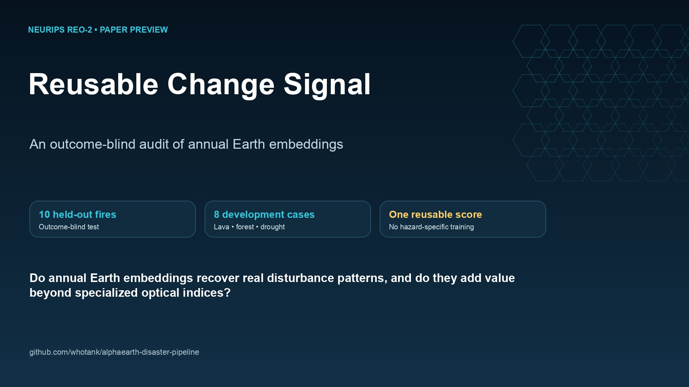

# Reusable Change Signal

Code and frozen evidence for:

> Hootan Kamran, Houman Kamran Habibkhani, and Atanaz Dorrani.  
> **Reusable Change Signal: An Outcome-Blind Audit of Annual Earth Embeddings.**  
> 2nd Workshop on Advances in Representation Learning for Earth Observation,
> NeurIPS 2026.

[Read the camera-ready paper](paper/main.pdf) ·
[Watch the 72-second preview](paper_preview_video/output/paper_preview_v1.mp4) ·
[See the citation metadata](CITATION.cff)



## What this repository evaluates

The study compares annual embedding displacement with event-specific mapped
references on a common H3 grid. The held-out test uses ten MTBS fires selected
and frozen before AlphaEarth extraction. Development cases cover lava
emplacement, forest loss, and drought.

The main result is evidence of reusable change signal, not a claim that
embedding displacement is a hazard detector:

- AlphaEarth median within-fire Spearman correlation: **0.712**.
- Mean AlphaEarth contrast against the stronger matched dNBR/dNDVI baseline:
  **-0.116**, 95% event-bootstrap interval **[-0.393, 0.079]**.
- TESSERA showed the same qualitative pattern in nine evaluable fires.
- All eight development associations were positive, with heterogeneous effect
  sizes.

## Quick start

Python 3.12 or newer is recommended.

```bash
python -m venv .venv
source .venv/bin/activate
python -m pip install -r requirements.txt
python verify_release.py
python -m pytest
```

Earth Engine extraction additionally requires an authenticated Google Cloud
project:

```bash
earthengine authenticate
export EE_PROJECT_ID=your-project-id
```

Build the paper:

```bash
cd paper
latexmk -pdf -interaction=nonstopmode -halt-on-error main.tex
```

Validate or rebuild the preview video:

```bash
python paper_preview_video/build_preview_video.py --validate-only
python paper_preview_video/build_preview_video.py
```

## Repository guide

- `paper/` — camera-ready TeX, bibliography, figure, and compiled PDF.
- `studies/mtbs_heldout_20260817/` — held-out implementation, frozen protocol,
  cohort, cell populations, and fire results.
- `tessera_mtbs_secondary.py` and `outputs/tessera_mtbs_secondary/` —
  prespecified TESSERA implementation and compact results.
- `outputs/reo2_development_spatial_robustness/` — non-fire spatial
  sensitivity.
- `paper_preview_video/` — reproducible, caption-led preview built from study
  imagery and frozen numbers.
- `outputs/reo2_fire_lava_visual_pair/` — selected Kīlauea, Rhea, and Woolsey
  visual products used for figures and communication.
- `docs/` — study, data, and reproducibility details.

The compact release retains the exact negative, weak, and missing outcomes
used in the paper. Regenerable caches, temporary exports, and raw third-party
archives are intentionally excluded.

## Data and licensing

The software is released under the [MIT License](LICENSE). Upstream imagery,
embeddings, and reference products remain subject to their source licenses and
terms. See [docs/DATA.md](docs/DATA.md) before redistributing derived assets.

For a precise replay map and known access requirements, see
[docs/REPRODUCIBILITY.md](docs/REPRODUCIBILITY.md).
